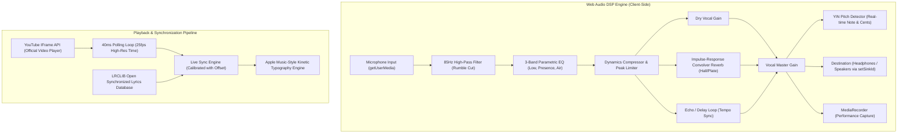

# 🎤 Karaoke Studio — Universal Cross-Platform Karaoke Platform

> **An industry-standard, zero-install, cross-platform Karaoke web application built for live stage performances, rehearsals, and home parties.**  
> Works seamlessly on **Windows, macOS, iOS, Android, and Smart TV browsers** with zero software installation required.

---

## ✨ Overview

Singers of all genres—from **Bollywood, Tollywood, and Punjabi hits to Hollywood and global anthems**—often struggle with disjointed YouTube karaoke videos, out-of-sync lyrics, and flat, uninspired raw microphone sound over speakers.

**Karaoke Studio** solves this by unifying:
1. **Universal Song Engine**: Stream verified pure karaoke backing tracks or official studio masters directly via YouTube's official player with legal licensing compliance.
2. **Real-Time Studio Vocal Chain (Web Audio API)**: Plug in your mic and headphones to get zero-latency concert hall reverb, tempo delay, compression limiter, and live vocal pitch tracking.
3. **Apple Music-Style Synchronized Lyrics**: Millisecond-accurate timed lyrics (`.lrc`) with smooth active line zoom, fluid gradient fills, and Romanized English transliteration for Indic scripts (Hindi, Telugu, Tamil, Punjabi).
4. **Live Timing Calibration**: On-the-fly millisecond sync offset controls (`[-0.5s]` `[+0.5s]`) that automatically remember calibration settings per song in `localStorage`.
5. **Real-Time Vocal Suppressor**: Client-side center-channel phase cancellation ($L - R$) with low-frequency bass recovery to isolate vocals when no pre-made karaoke track exists.
6. **Hardware Device Routing**: Select your preferred USB microphone, external sound card, or headphones/speakers directly with native Web Audio output device selection (`setSinkId`).

---

## 🛠️ Architecture & Audio DSP Pipeline



---

## 🚀 Key Features

### 🎙️ The Singer's Studio Console
- **Concert Hall Reverb**: Algorithmic impulse response convolver providing rich, studio-grade room ambiance.
- **Vocal Delay / Echo**: Synchronized delay with feedback control for vocal depth.
- **Compressor & Limiter**: Prevents harsh digital clipping when hitting high, powerful notes.
- **Real-Time Pitch Guide**: Fast Autocorrelation / YIN fundamental frequency detection displaying current musical note (e.g. `C4`, `G#4`) and cents tuning accuracy.
- **Pitch Transposition (Key Change)**: Shift song key between **-6 to +6 semitones** to fit your natural vocal range.
- **Performance Recorder**: 1-click recording that mixes your processed vocals and backing track into high-definition WebM/WAV for instant download.

### 🎵 Universal Song Search & Library
- **Live YouTube & LRCLIB Search (`/api/search`)**: Query any song across Hollywood, Bollywood, Tollywood, Punjabi, or global catalogs. The engine simultaneously queries YouTube for verified karaoke versions and official audio, while querying LRCLIB for timestamped lyrics.
- **Direct YouTube URL Importer**: Paste any YouTube video link or ID directly into the search bar.
- **Seamless Karaoke $\leftrightarrow$ Original Toggle**: Switch between the pure karaoke backing track and original studio master mid-song without losing your playback timestamp.
- **Persistent Personal History**: Automatically saves your recently sung tracks and custom lyric syncs in `localStorage`.

### 📝 Synchronized Lyrics & Transliteration
- **Kinetic Glowing Typography**: Active line highlighting with smooth fluid fill and auto-centering scroll.
- **Romanized Transliteration**: Automatic toggle to convert Devanagari, Telugu, Tamil, and Gurmukhi scripts into phonetic English text.
- **60-Second Tap-to-Sync Editor**: Paste any plain text lyrics and tap Spacebar along with the song to create and export custom `.lrc` files.
- **Live Calibration Bar**: Real-time `[-0.5s]` `[+0.5s]` timing controls to lock lyrics to any video intro.

---

## ⚖️ Legal & Copyright Compliance

Karaoke Studio is built strictly as a **client-side karaoke player, practice suite, and audio visualization utility**:
1. **Zero Audio Hosting**: This platform does **not** download, rip, or host copyrighted MP3s on its servers.
2. **Official YouTube Playback**: Backing tracks stream directly through YouTube's official embedded IFrame Player. Through YouTube's automated **Content ID** system, record labels and copyright owners receive their full mechanical and performance royalties.
3. **Client-Side DSP**: Real-time vocal filtering and microphone effects operate strictly in browser memory (RAM) for private practice under fair use.

---

## 💻 Tech Stack

- **Framework**: [Next.js 14+ (App Router)](https://nextjs.org/)
- **UI & Styling**: [Tailwind CSS](https://tailwindcss.com/), [Lucide React](https://lucide.dev/), [Framer Motion](https://www.framer.com/motion/)
- **Audio Processing**: Native Web Audio API (`AudioContext`, `ConvolverNode`, `BiquadFilterNode`, `DynamicsCompressorNode`, `MediaStreamDestination`)
- **Pitch Detection**: Normalized Square Difference / YIN Autocorrelation Algorithm
- **Search & Lyrics**: [yt-search](https://www.npmjs.com/package/yt-search), [LRCLIB API](https://lrclib.net/)
- **Package Manager**: [pnpm](https://pnpm.io/)

---

## 🚀 1-Click Deployment (Vercel)

Deploy your own live instance of Karaoke Studio on Vercel with zero configuration:

[](https://vercel.com/new/clone?repository-url=https%3A%2F%2Fgithub.com%2Fmitrank%2Fkaraoke-studio)

1. Click the **Deploy with Vercel** button above or visit [vercel.com/new](https://vercel.com/new).
2. Select your GitHub repository: **`mitrank/karaoke-studio`**.
3. Click **Deploy**. Vercel will automatically build the project and launch your live serverless URL (`https://karaoke-studio.vercel.app`) with automatic redeployment on every `git push`.

---

## 📦 Getting Started

### Prerequisites
- [Node.js](https://nodejs.org/) v18.17+ or v20+
- [pnpm](https://pnpm.io/) (`npm install -g pnpm`)

### Installation

1. **Clone the repository:**
   ```bash
   git clone https://github.com/mitrank/karaoke-studio.git
   cd karaoke-studio
   ```

2. **Install dependencies:**
   ```bash
   pnpm install
   ```

3. **Run the development server:**
   ```bash
   pnpm dev
   ```

4. **Open in your browser:**
   Open [http://localhost:3000](http://localhost:3000) to start singing!

### Production Build
To create an optimized production build:
```bash
pnpm build
pnpm start
```

---

## 📄 License
This project is open-source and available under the [MIT License](LICENSE).
